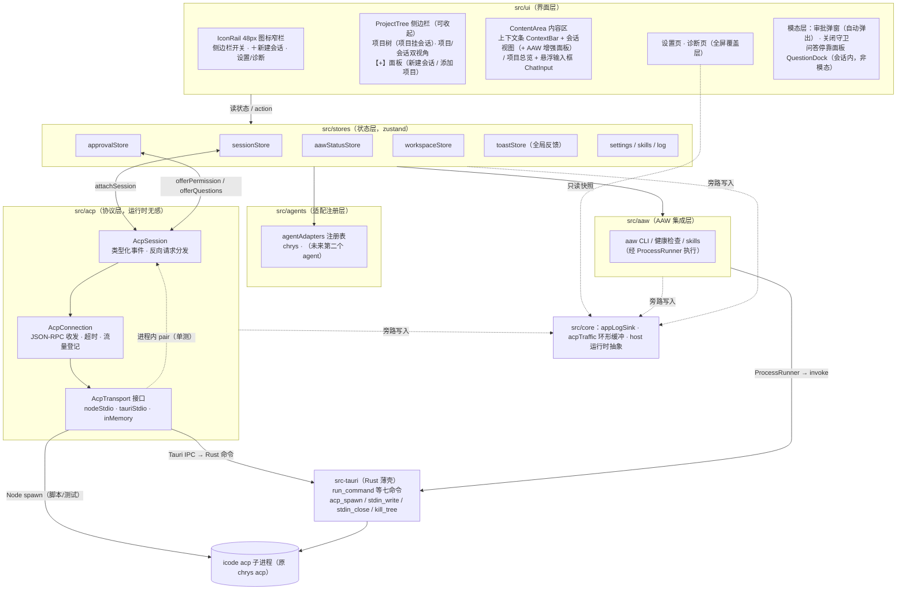

# 架构（desktop/）

> 状态：**可用并经真机验收**（ACP 握手 / 真实对话 / 结构化提问 / 文件
> 写入均实测通过；审批反向请求的响应形状已对齐 chrys SDK 校验）。
> 分层职责见各 `src/<layer>/README.md`，工程规范见
> `docs/conventions.md`，演进决策与已知问题见 `docs/HANDBOOK.md`。

## 分层图

## 事件数据流

1. **上行（agent → 界面）**：`icode acp`（原 `chrys acp`）的 stdout 行 → transport（分帧）
   → `AcpConnection`（JSON 解析、请求响应关联、wire 登记 `acpTraffic`）
   → `AcpSession`（通知翻译为类型化事件 `AcpSessionEvent`，chrys 私有
   通知经方言钩子 `AcpDialect` 翻译）→
   `sessionStore.handleEvent` 折叠为会话条目 / `aawStatusStore` 触发节流
   自动刷新 / `runtimeStatusStore` 落 runtime/usage 快照与轮内相位
   （三者经 `ui/sessionBridge.ts` 桥接；桥还订阅 sessionStore 的
   `isAgentRunning` 驱动轮次状态机的起止）→ 组件按选择器重渲染。
   反向请求（`session/request_permission` 标准请求经回调；
   `_chrys/request_input` 经方言钩子）进入
   `approvalStore.offer*` 挂起，用户决策后沿同一 Promise 回传 wire 响应。
2. **下行（界面 → agent）**：组件调用 store action（`sendPrompt` /
   `requestCancel`）→ 绑定的 `SessionBinding` 发起 `session/prompt` 请求
   或 `session/cancel` 通知 → transport 写 stdin。
3. **可观测（旁路）**：所有层写 `core/logger`（`appLogSink` 环形缓冲）；
   `src/acp` 每条 wire 消息登记 `acpTraffic`。诊断页只读快照，不自行累积。

## Rust 薄壳与 stdio transport 选型

结论：**自写最小命令集**（`src-tauri/src/acp_process.rs`：`acp_spawn` /
`acp_stdin_write` / `acp_stdin_close` / `acp_kill_tree` + `acp://stdout`
`acp://stderr` `acp://exit` 三个事件），不用 tauri-plugin-shell。理由：

| 评估点          | tauri-plugin-shell v2                                                                                                                                                                                     | 自写命令集（已选）                                                                                                                                      |
| --------------- | --------------------------------------------------------------------------------------------------------------------------------------------------------------------------------------------------------- | ------------------------------------------------------------------------------------------------------------------------------------------------------- |
| 关 stdin 发 EOF | **无此 API**（`Child` 只有 `write`）。而 `AcpTransport.close(graceMs)` 的语义是「关 stdin → 等对端自退 → 超时升级杀树」（对齐 Python 参考 `session.py` 的关闭路径，`acpTransport.ts` 接口注释即如此约定） | `acp_stdin_close` 即 drop 写端                                                                                                                          |
| 进程树终止      | `processGroup` 选项（Windows Job / POSIX 进程组），语义与参考实现不同且默认关闭                                                                                                                           | Windows `taskkill /PID <pid> /T /F`、POSIX SIGTERM→宽限→SIGKILL，与 `nodeStdioTransport` 及 skill-eval Python 参考的 `_terminate_process_tree` 逐字对齐 |
| 程序路径授权    | capability 静态白名单（name→cmd 固定）；chrys 路径是设置页可改的任意路径，静态白名单不可用，放开 scope 等于放弃权限模型                                                                                   | 自定义命令默认仅应用内可用，路径由 TS 侧设置传入                                                                                                        |
| 行分帧          | 插件内置（piped 即按行）                                                                                                                                                                                  | Rust 侧 `read_until(b'\n')` + 16MB 上限，与 TS `LineDecoder` 同参数                                                                                     |
| 依赖面          | 新增 Cargo + npm + capability 三处                                                                                                                                                                        | 零新增依赖，与既有 `run_command` 等七命令同一模式                                                                                                       |

IPC 边界的一处固有差异如实记录：`writeLine` 的同步签名下，异步写入失败
不能同步抛 `AcpWriteError`——`tauriStdioTransport` 的策略是句柄已知失效
时同步抛，异步失败经 `onStderr` 旁路报告；进程死后 `acp://exit` 随即
到达，连接层的挂起请求由 `AcpClosedError` 唤醒，行为与 Node 实现等价
（`tests/acp/tauriStdioTransport.test.ts` 覆盖）。

Tauri 侧纪律：薄壳只做进程管道转发与事件广播，优雅关闭的编排（关
stdin → 等 exit → 超时升级 kill）在 TS transport 内完成，与 Node 实现
共用同一套时序语义；业务逻辑不进 Rust。

Rust 侧进程表的生命周期：`acp_spawn` 注册、退出后表项保留（终态可查、
`acp_kill_tree` 幂等收口），由前端 transport 的 `dispose()` 调
`acp_release` 显式释放——反复开关会话不会滞留表项。进程语义有
`#[cfg(test)]` 自动化测试兜底（`cargo test`）：stdout 手动分帧（半包 /
CRLF / 空行）、`run_command` 超时杀进程与 spawn 失败、`copy_dir` 先删
后拷覆盖语义、杀树真实终止子进程、`acp_release` 幂等清除表项。

**孤儿防线（双层）**：agent 进程树若比桌面端活得久，会抱着 chrys 的
配置/会话锁不撒手，下一次启动 agent 要与孤儿抢锁（实测 initialize 从
2s 拖到 20s+）。第一层是关窗纪律——CloseRequested 一律转交前端，空闲
也先 `closeRealRuntime` 再 `force_close`；第二层是 `acp_spawn` 把每棵
agent 树挂进 Windows Job Object（KILL_ON_JOB_CLOSE）：桌面端无论正常
退出、崩溃还是被强杀，OS 收走 job 句柄的瞬间整棵树终止，孤儿在机制上
不可能存在（POSIX 无对应机制，靠第一层 + stdin EOF 自退）。

## 界面装配（生产通路）

主界面为「图标窄栏 + 侧边栏树 + 内容区」单页结构（原「开发 / 项目」
两页已合并；设置与诊断是内容区全屏覆盖层，入口在图标窄栏底部）：

- **项目树**（`ui/workbench/ProjectTree`）：项目为父节点、会话为子
  节点；「项目 / 会话」双视角（会话视角为跨项目最近活跃拍平）；段头
  【+】面板承载「新建会话（选项目直接开空对话）/ 添加项目」；
  树行「＋ 新会话」与面板项目行同走 `ui/workbench/sessionStart.ts`
  的 `startNewSession`（`forceNew`：真新建，不落进上次对话），不经
  AAW 入口向导；
- **会话子节点的两个数据来源**：已连接项目以 ACP `session/list` 为
  权威（`realRuntime` 回填 `setSessions`）；未连接项目由装配组件
  `SessionHistoryBinding` 经 `ui/workbench/sessionHistory.ts` 读 agent
  会话索引补充（`src/agents/chrysSessions.ts` → 只读
  `<sessions>/.cache/session_catalog.json`），落进同一处
  `sessionStore.sessionsByPath`（`mergeSessionHistory` **只补空缺项
  目**）。于是**冷启动就能看到历史**，不必先 spawn agent；
- **点会话子节点**：所属项目未连接时先 `openRealWorkspace`（自动重
  连，含 session/list → loadSession 恢复优先，失败回落 newSession）
  再 `switchRealSession`；恢复了历史会话时内容区自动切到会话视图；
- **项目总览**（`ui/workbench/ProjectOverview`）：健康检查（agent 可
  执行 / uv / aaw CLI / .sdd/，前三项并行探测）+ 工具路径编辑 + aaw
  状态面板 + 唯一主动作「新建会话」（连接是它的内部步骤）；会话入口
  不在总览——会话挂在树上（项目 → 会话），进哪条对话由树的会话行
  承担；按钮不点名具体 agent——用户的心智是「开始一条会话」，
  agent 身份由连接徽标与设置页承载（`registry.ts` 的
  `defaultAgentLabel()`）；项目没有 .sdd/ 时工作流面板收成一行；连接
  失败有错误横幅（含「打开设置」深链）；
- **会话内的 AAW 增强**（`ui/workbench/SessionAawPanel`）：上下文条的
  AAW 开关（有工作流数据时标签即 `SR-xxx · 步骤 n`）开合右侧抽屉，
  「进度」分段渲染 `AawStatusPanel`——默认不露 `done` 命令行（那是
  skill 派给 agent 的动作，不是用户的活），只留「放行进入下一步」这
  一个按人话说的动作，交给会话的是自然语言请求；「启动」分段渲染入口
  向导（首条 prompt 走 `ui/workbench/wizardSubmit.ts`）；AAW 是增强，
  对话始终占主区；
- **上下文条**（`ui/workbench/ContextBar`）：随内容区形态切换——会话
  态（标题 · 项目 · 连接徽标 · AAW 开关 · 关闭会话带确认）、总览态
  （返回 + 项目名 + 路径）、全屏页态（返回 + 页名）。窗口装饰已关
  （decorations: false），它同时就是**自绘标题栏**：空白 spacer 带
  data-tauri-drag-region 可拖窗，右端 `WindowControls`（最小化 / 最大化
  / 关闭，关闭走 CloseRequested 与关闭守卫同路），非 Tauri 环境不渲染；
- **关闭守卫**（`App.tsx CloseGuard` + Rust `on_window_event`）：
  CloseRequested 一律转交前端——无运行任务直接 `force_close`；agent
  运行中或有挂起审批时弹确认，「中断并关闭」先取消轮次与挂起审批、
  `closeRealRuntime` 杀进程树，再 `force_close`；
- **AAW 面板数据源**：装配组件 `AawStatusLoaderBinding` 按内容区所示
  项目把 `src/aaw/statusLoader.ts` 的 CLI loader（含 `next --peek`）
  注入 `aawStatusStore`；会话事件自动刷新经 `ui/sessionBridge.ts`；
- **可观测**：诊断页（全屏）只读 `core/logger` 的运行日志与 ACP wire
  环形缓冲。挂起审批经 ApprovalModal 自动弹出，问答经会话内
  QuestionDock 停靠面板承接（顶栏不再设「待办」入口）。

## 扩展第二种 agent 的步骤

**三种接入形态**（`src/agents/registry.ts` 的 `resolveAgentAdapter` 统一解析，
设置页「Agent」卡片是管理入口，真实运行 `realRuntime` 与协议探查
`agentProbe` 都从这里取启动面）：

1. **内置适配项**：在 `agentAdapters` 追加一个 `AgentAdapter`（id /
   displayName / `buildLaunch` 产出 argv 与 env / clientInfo / notes；
   有私有扩展再提供 `createDialect`）。讲标准 ACP 的 agent 到此即完成。
2. **本机发现（native-\*）**：`nativeAcpCandidates` 收录「子命令直接说
   标准 ACP」的 CLI（如 `opencode acp`）；设置页经 where/which 扫描，
   命中即列为可用 agent，无需改代码。
3. **自定义（custom-\*）**：设置页直接添加（名称 + 命令行，双引号可含
   空格路径，`parseCommandArgv` 切 argv），持久化在 settings.v1。

若有私有扩展：在注册项的 `createDialect` 里挂 `AcpDialect` 钩子——
私有通知翻译（返回 null 交回协议层）与私有反向请求处理器（按
method 精确匹配）。协议层只负责标准 ACP 翻译与兜底透传
（`unknown_notification` / -32601），不硬编码任何具体 agent 的私有
方法名（chrys 方言即住在 `src/agents/chrysDialect.ts`，经此钩子
注入）。native / 自定义 agent 无方言——未知消息走兜底透传，数据不丢。

`src/ui`、`src/core`、transport 实现均不动；进程承载统一走
`src/ui/agentTransport.ts` 工厂（Tauri IPC / dev bridge 两实现，
协议自检与真实会话共用，防两处漂移）。

**协议自检（设置页「Agent」分片的报告卡，与 agent 列表同处）**：对任意已配置 agent 真实 spawn
一条 ACP 连接核验我们的全部接口依赖——安全探查（initialize →
session/new → 收早期通知 → session/list → close，零模型调用）与深度
探查（另发一轮极小 prompt 观测事件形状）；结果经 `protocolProbeStore`
中转，`protocolChecks.ts` 纯函数推导为分组检查表（每行：状态徽标 +
依据 + 缺失时的功能影响）。不同底座各跑一次即得差异对照（chrys：
chrys_* 扩展全绿；OpenCode：models/modes 不下发、标准 usage_update
与命名空间 `session/update:*` 通知「已收到未消费」）。探查期的权限/
提问反向请求一律计数后回「取消」，绝不放行。

## 关键技术决策

| 决策             | 选择                                                          | 理由                                                                       |
| ---------------- | ------------------------------------------------------------- | -------------------------------------------------------------------------- |
| 框架             | Tauri 2 + React 19 + TS strict + Vite                         | 任务指定；Rust 壳 + Web 视图                                               |
| agent 进程长连接 | 自写 Rust 命令集 + `tauriStdioTransport`（见上节）            | stdin EOF、杀树语义、动态路径三处硬需求插件不满足                          |
| ACP SDK          | `@agentclientprotocol/sdk` 主入口（v1 stable）                | chrys 协议版本为 1（参考实现 `PROTOCOL_VERSION = 1`）；v2 尚 experimental  |
| 状态             | zustand v5                                                    | 任务指定；选择器订阅控制渲染粒度                                           |
| lint/format      | ESLint（typescript-eslint，typeChecked）+ Prettier            | 「禁止 any 兜底」需要类型感知规则（`no-unsafe-*`）；格式与质量分工互不冲突 |
| 样式             | Tailwind CSS v4（`@tailwindcss/vite`）                        | 无配置文件、与 Vite 原生集成、工具类直写符合快速迭代                       |
| Markdown         | react-markdown + rehype-highlight（highlight.js github-dark） | 同步渲染、轻量；shiki 留作后续按需升级                                     |
| 测试             | Vitest + RTL + jsdom，目录镜像 src 分层                       | 任务指定；`vitest run` 非 watch                                            |

## 会话信息面与 AAW 时间线（2026-10 改造）

- `runtimeStatusStore`（src/stores）：iCode 推送的 `chrys_runtime`
  （三形状字段级合并；`runtimeDetails` 严格收窄出模型 / MCP / skill
  来源）与 `chrys_usage`（主 agent 窗口占用 pct 与 token 明细）此前在
  UI 层被整体丢弃——现在统一落到这一个 store，`InputStatusBar`
  （输入区下行）消费为模型 · 上下文用量条 · skills/mcp 徽标 · 轮内
  相位章（思考中 / 工具运行中 n / 生成中）。轮次起止由桥接层订阅
  `sessionStore.isAgentRunning` 驱动，store 之间仍不互相 import。
- AAW 时间线（ui/workbench/timeline/，紧凑条 + 抽屉两态）：常驻一行
  紧凑进度条（SR · 每站一格的分段进度 · n/N · 当前站中文短名），点
  「流程」从条下沿滑出抽屉浮层给完整地铁图（横轨 + 站灯 + 运行心跳，
  中文短名 + 技术 ID 副行，Esc / 点外部关闭），默认收起、偏好持久化。
  站名经 `stationNames.ts` 友好化（sr-design-gate → 详设门禁、
  T{序号}-dev-task-dev → 任务开发；词表对着 flow.yaml 节点全集，未知段
  原样回落）。`deriveStepPhases` 同步修复：failed / blocked / superseded
  不再被抹成待办，失败步骤在所有视图可见。
- 结构化问答从模态改为停靠面板（ui/session/QuestionDock.tsx）：挂在
  会话流与输入区之间，无遮罩——回答所需上下文就在上方；全部问题一次
  可见（已答 n/N），每问支持 note 备注随答案回传（协议 ChrysAnswer.note，
  `approvalStore.submitAnswers` 第三参）。

## dev:web 浏览器开发运行时（2026-10）

`npm run dev:web` = vite dev server + 内嵌 dev bridge 插件
（`scripts/devBridgePlugin.ts`，`AAW_DEV_BRIDGE=1` 门控、`apply:"serve"`，
构建零参与）。插件在同源 `/dev-bridge/*` 上暴露与 Rust 命令面同构的
HTTP 端点与 SSE 事件流（acp-stdout/stderr/exit），进程语义复用
`nodeStdioTransport` / `nodeProcessRunner`，文件/chrys 目录语义按
commands.rs 复刻。前端在三条既有缝后面换实现：
`HostRuntime`（host.ts 环境探测）、`ProcessRunner`
（tauriProcessRunner 的缺省导出）、`AcpTransport`（realRuntime 的
transport 选择），分支以 `import.meta.env.DEV && !import.meta.env.VITEST`
内联门控——生产构建折叠为死代码，bridgeClient（`src/dev/`）整棵摇出
产物。生命周期纪律：SSE 断开 10s 无回连或 vite 退出 → 杀全部 agent
进程树，与桌面端孤儿进程治理对齐。详见 HANDBOOK §2。

## 参考实现索引（协议细节的权威来源）

- Python ACP 客户端（已在 skill-eval 跑通）：
  `skill-eval/.../protocols/acp/session.py`（超时/通知/进程树终止）、
  `wire.py`（chunk / 工具输入摘要）。
- chrys 服务端：`D:/dev/workspace-ai/chrys/src/chrys/app/acp/`
  （`server.py` 的 initialize 与 `_request_permission` /
  `_request_input`、`session_manager.py`、`content.py`）。
