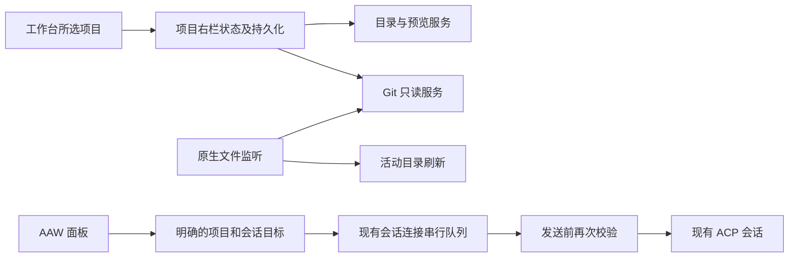

# 项目右栏第一版

## 已确认的产品规则

- 工作台层提供 AAW、文件、Git 固定入口及可关闭内容标签。按项目共享，切换会话不清空；切换项目隔离。
- 首次默认收起；持久化项目标签、活动标签、开合和宽度。只恢复引用，重新读取内容；不连接 ACP、不发送命令。
- 窄窗口覆盖显示，正常窗口并排；开关右栏不重新挂载聊天输入框。
- AAW 复用现有工具配置及所选项目 `.sdd` 状态。会话页面明确发送给该会话；总览必须选择已有会话或新建。异步连接后再次校验项目、会话和当前选择。
- 文件树逐层加载，包含隐藏目录。允许明确绝对路径打开项目外文件/临时目录，不改变项目或执行 cwd。相对链接不得越出其项目；符号链接可手动展开，不自动递归。
- 文本/代码只读，256 KiB 上限，超限不显示片段。Markdown/SVG 可切换预览和源码；图片 4 MiB 上限、适应区域；HTML 为源码；其他格式明确提示。
- 文件预览沿用 ZCode：打开或切换预览源时读取，不监听内容变化，无暂停开关。文件树、Git 保留局部监听及手动刷新。
- Git 识别真实仓库根及元数据目录，变更列表按项目过滤；重命名的新旧路径任一位于项目即保留。来源切换未暂存（含未跟踪/冲突）、已暂存、全部分支更改、上一轮更改；分支使用 upstream...HEAD，上轮保留空态。
- Diff 统一视图、按需加载、过大降级/明确截断；不提供编辑、暂存、提交、回滚、左右布局或冲突解决。
- AAW 草稿在本次运行中切标签/收起保持，重启不恢复。

## 所有者与事件

原生层负责有界读取、Git 参数数组、监听注册和释放。UI 状态不保存文件正文。请求按项目/标签及代次隔离，关闭或切换使旧响应失效。文件预览不订阅监听事件。Git 和目录刷新合并突发事件并限制并发；失败保留可见原因，不当成空目录/干净仓库。

## 验收

1. 无 ACP 连接即可查看文件、Git、AAW；恢复右栏不会启动 agent。
2. A/B 项目快速切换，迟到响应不覆盖新项目；AAW 不串会话。
3. 同项目切会话、收起右栏不清空标签或聊天草稿；重启恢复引用。
4. 目录增删自动刷新，外部临时目录不启用项目 Git/监听；文件预览保持已读取版本。
5. Git 子目录范围、跨边界重命名、未提交初始仓库、中文/空格路径、二进制及超大文件有明确结果。
6. 重复开关及快速切换不会泄漏 watcher；窄窗可返回聊天，键盘可关闭抽屉。

## Git 审查交互补齐（沿用 ZCode）

- 文件行内展开统一 Diff，同时仅展开一个文件；按需加载，不因点击创建新标签，旧 Diff 标签仍可读。
- 每文件显示 numstat 新增/删除数；不增加顶部汇总、文件名过滤或文件历史入口。
- 内容查找 trim、忽略大小写、字面匹配，显示命中编号及循环前后跳转；自动展开并定位高亮。路径、Git 元数据不参加匹配。完整前后内容可用时搜索两侧，否则搜索可显示的 patch 内容。
- 未跟踪零文本统计项沿用 ZCode 从审查列表过滤：空文件、二进制、超限、不可读；文件树仍可查看。已跟踪二进制显示 +0/-0，展开提示二进制。
- 分支比较使用本地上游与 HEAD 的共同祖先，不执行 fetch；无上游显示空态。上一轮没有轮次快照，保留空态，不以工作区差异代替。
- Diff 缓存按项目版本、来源、路径隔离；刷新使旧结果失效。搜索加载当前来源文件，限制读取并发和内容体积，卸载停止后续调度。长文件列表虚拟滚动。

验收：暂存/未暂存统计隔离、重命名与项目范围、上游三点比较、无上游/无提交、未跟踪统计规则；单文件展开、跨文件查找、刷新/切源/切项目迟到结果失效。
