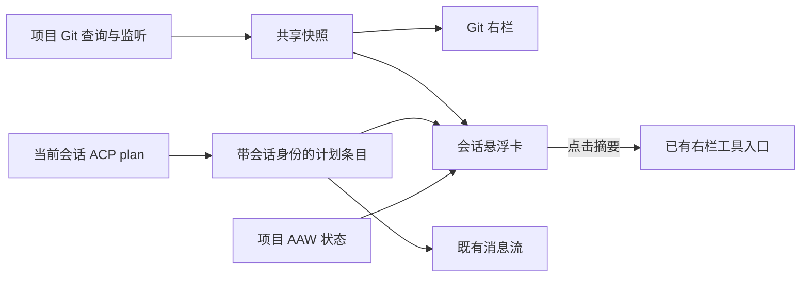

# 会话状态悬浮卡

用户已确认的第一版范围（Q1–Q8）：

- 会话区域右上角固定卡片，宽 320px；auto 在聊天容器宽度 1280px 时展开，否则胶囊。允许手动展开、收起和恢复自动；无拖动、无独立系统窗口。空草稿不显示。
- Git 只读：分支名、增删汇总、打开已有 Git 右栏。暂存和未暂存（含未跟踪文本/冲突）分别累加；0/0 隐藏 Git 分区。点击更改优先打开未暂存，否则已暂存。无提交、推送、分支切换。
- 标题“任务进度”：当前会话最新 ACP plan，只读；保留消息流的历史卡。≤6 项全部展示，>6 项展示当前项起的三项窗口，其余通过悬停/焦点/点击预览；全完成仍保留绿色 N/N。
- AAW 跟随项目面板当前 SR，同项目各会话共享选择。显示编号、状态、当前步骤、已完成/已生成步骤数；完成依赖 next.done，不把 N/N 推断为流程完成。点击打开 AAW 进度面板，不直接推进流程。
- 胶囊优先：当前任务步骤 → 未结束 AAW → Git 增删 → 已完成状态。错误不伪装为空态，过期快照标明刷新失败。
- 展开偏好仅在本次运行保持，跨项目/会话共享；重启回 auto。各分区默认展开；无有效内容时隐藏整卡。
- 主滚动视口保持全宽，滚动条位于悬浮卡右侧；只给内部消息列、输入框和问答/队列停靠区应用相同留白。同步滚动条占位，展开、收起或缩放后左右边缘仍对齐。

## 提问刻度导航

参考 ZCode，在会话左侧显示每条用户提问的刻度。系统通知、思考、工具与助手输出不单独建项。悬停 120ms 或键盘聚焦后在右侧预览问题与回复摘要（两行问题、三行回复）；相邻刻度随焦点伸长。当前阅读位置高亮，最后一条正在处理的提问稍加强调。

点击刻度跳到对应提问，默认平滑滚动，尊重系统减少动画设置；暂停自动跟随，新回复不会把阅读位置拉到底部，也不会挤掉当前历史窗口。主动滚动至底部或点击“回到底部”恢复跟随。切换会话重置导航与渲染窗口。

目录覆盖当前会话已恢复的全部提问，不受正文初始 150 条渲染窗口限制；点击更早提问时先补齐现有窗口再定位，不额外连接 ACP 或读取其他会话。目录自身虚拟渲染、可独立滚动；少于两条提问或聊天容器小于 864px 时隐藏。正文原生滚动条始终保留。

## 状态与隔离

Git 按规范化项目路径共享一份查询和监听，右栏、旧 Diff 标签与悬浮卡订阅同一快照。最后订阅者卸载时释放监听；重挂重读；突发刷新合并，旧代响应不覆盖新代。

plan 在 ACP 事件写入时记录 sourceSessionId，并随既有本地快照保存。浮层只使用与当前会话 ID 一致的最新 plan；切换中隐藏计划。旧快照缺少身份时仍保留流内历史，但不冒充当前计划。

AAW 复用既有 store 和 CLI 配置，不单独扫描或启动进程。store 暴露绑定项目身份用于同步校验，切项目过渡帧不得展示上一个项目的 SR。

## 验收

宽窄布局和右栏展开联动；开合不重挂聊天输入；长清单预览可通过键盘/鼠标访问；不同会话计划隔离、旧快照不串会话；AAW 空态/错误/待放行/完成区分；Git 同时订阅只查一份、关闭释放、刷新失败保留标记；摘要入口不连接 ACP、不发送指令。
